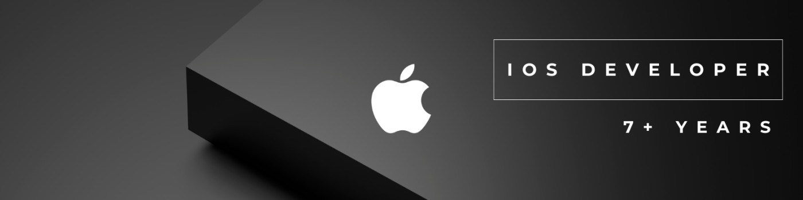

# Sultan Almukhan

**Senior iOS Engineer | AI-Assisted Development | Full-Stack Engineering**

I build iOS applications from architecture to release, with 7+ years of experience across mobile engineering, real-time audio, and AI integrations.

My focus is on building reliable products with Swift, modernizing codebases, and using AI-assisted engineering workflows to improve development efficiency.

### Tech Stack

**Mobile:** Swift · SwiftUI · UIKit · Swift Concurrency · AVFoundation

**AI & Backend:** LLMs · Claude Code · AI Agents · MCP · Next.js · TypeScript

**Engineering:** Architecture · Testing · CI/CD · Fastlane

### Selected Work

**[Personal Portfolio](https://github.com/sultanalmukhan/profile)**  
A portfolio built with React, TypeScript, and Vite, featuring selected applications and engineering work.  
[Visit Website](https://sultanalmukhan.com/)

### Connect

[Portfolio](https://sultanalmukhan.com/) · [LinkedIn](https://www.linkedin.com/in/salmukhan/) · [GitHub](https://github.com/sultanalmukhan)
